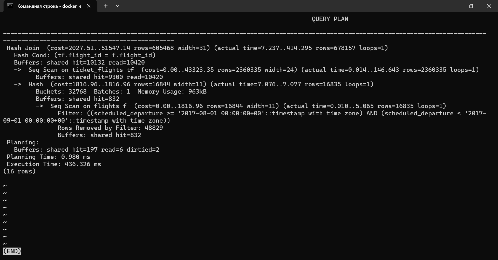
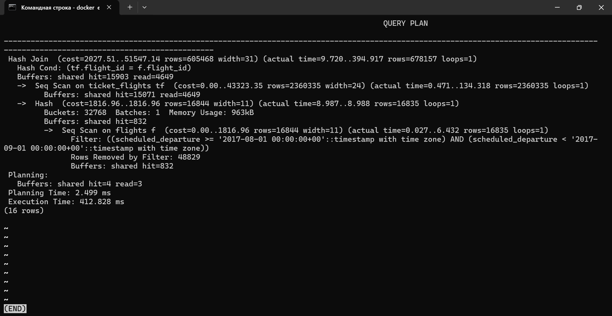
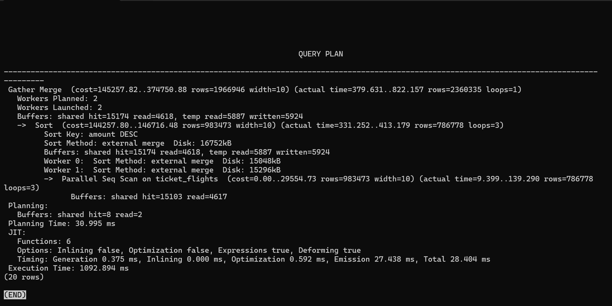
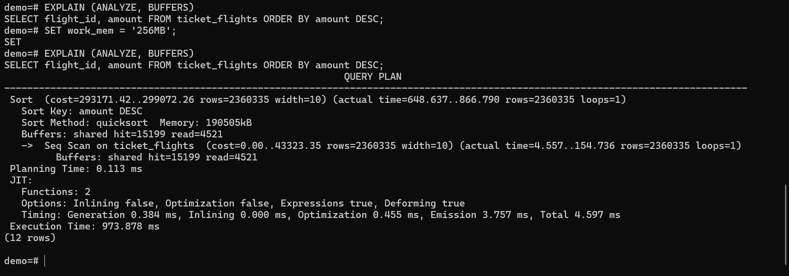
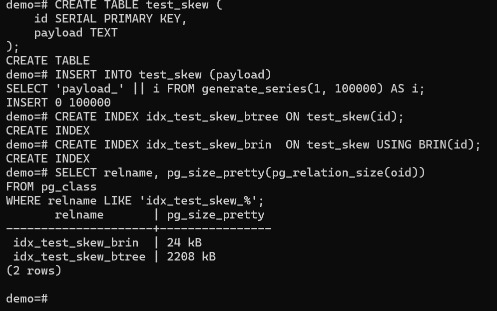
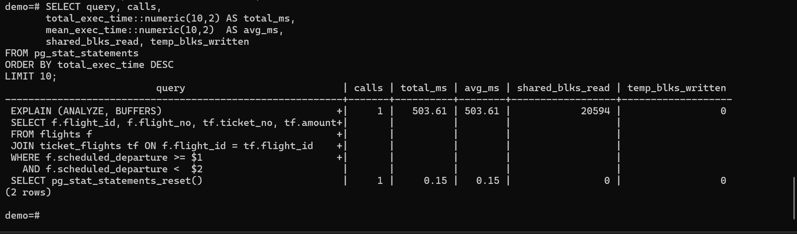

# ДЗ №7

## 1. Pre-flight Checklist

Был выполнен запрос к `pg_stat_user_tables` для таблицы `flights`. 
Показатель `n_mod_since_analyze` был незначительным, поэтому дополнительный `ANALYZE` не требовался.

## 2. Анализ кэша и прогрев 

**До прогрева:**

В плане запроса видно `Buffers: shared read=10420` (чтение с диска). Время выполнения: 436.326 ms.

**После прогрева:**

Выполнено `pg_prewarm` для таблиц `flights` и `ticket_flights`. 
В новом плане `Buffers: shared hit=15903 read=4649` (большая часть данных взята из кэша). Время выполнения: 412.828 ms.

Вывод: `pg_prewarm` загружает данные в оперативную память (кэш), что уменьшает количество физических чтений с диска и ускоряет выполнение запросов.

## 3. Исследование work_mem

**С настройками по умолчанию:**

В плане запроса видно `Sort Method: external merge Disk: 16752kB`. Сортировка не поместилась в память и использовала диск. Время: 1092.894 ms.

**После увеличения work_mem до 256MB:**

`Sort Method: quicksort Memory: 190505kB`. Диск больше не используется, вся сортировка прошла в памяти. Время: 973.878 ms.

Вывод: Увеличение `work_mem` позволяет выполнять сортировку и хеширование в оперативной памяти, избавляя от медленных операций ввода-вывода (чтения/записи временных файлов на диск).

## 4. Сравнение индексов

В таблицу `test_skew` было вставлено 100 000 строк. Созданы два индекса.

**Результат**

- `idx_test_skew_brin` — 24 kB
- `idx_test_skew_btree` — 2208 kB

Вывод:*
BRIN занимает значительно меньше места, так как хранит только минимальные и максимальные значения для блоков страниц (а не каждое значение, как B-Tree). 
- B-Tree лучше использовать для OLTP-запросов (точечный поиск по ID, уникальные значения).
- BRIN идеален для больших таблиц с естественным порядком (логи, временные ряды), где нужен поиск по диапазону.
- fillfactor помогает B-Tree оставлять свободное место на страницах для будущих вставок, уменьшая разбиение страниц (page splits).
- Партиционирование разбивает большую таблицу на части, что позволяет использовать меньшие индексы и улучшает кэширование.

## 5. Диагностика pg_stat_statements

Была сброшена статистика, выполнен тяжелый аналитический запрос (JOIN таблиц `flights` и `ticket_flights`).

**Результат**

- Количество вызовов (`calls`): 1
- Среднее время (`avg_ms`): 503.61
- Прочитано блоков с диска (`shared_blks_read`): 20594
- Записано временных блоков (`temp_blks_written`): 0

Вывод: Запрос выполнился за 503 ms, прочитав достаточно много блоков с диска (так как кэш не был полностью прогрет). Временные файлы не использовались (`temp_blks_written = 0`), что говорит о достаточном объеме `work_mem` для данного конкретного запроса.
